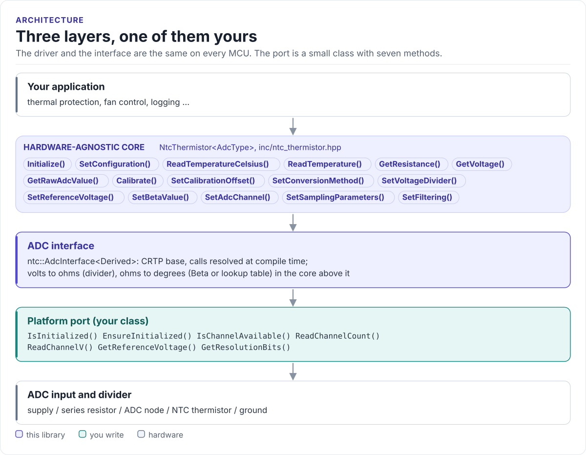

# NTC Thermistor Driver

A C++20 driver for NTC thermistors read through an ADC: it turns the voltage of a resistor divider into the
thermistor's resistance and then into degrees, with averaging, filtering and calibration, on any MCU.

[](https://github.com/hardfoc/hf-ntc-thermistor-driver/actions/workflows/ci-host-tests.yml)
[](https://github.com/hardfoc/hf-ntc-thermistor-driver/actions/workflows/esp32-examples-build-ci.yml)
[](https://hardfoc.github.io/hf-ntc-thermistor-driver/)
[](LICENSE)

**Documentation: <https://hardfoc.github.io/hf-ntc-thermistor-driver/>**

<!-- figure: driver-layers -->
<picture>
  <source media="(prefers-color-scheme: dark)" srcset="docs/diagrams/driver-layers.dark.svg">
  
</picture>
<!-- /figure -->

## In 30 seconds

Wire the thermistor from an ADC input to ground and a 10 kΩ resistor from the supply to the same input, write a
small ADC port class for your MCU ([Porting](https://hardfoc.github.io/hf-ntc-thermistor-driver/latest/porting/)),
then:

<!-- generated: quickstart-code -->
```cpp
#include "ntc_thermistor.hpp"

#include <cstdio>

int read_board_temperature(MyAdc& adc, float& celsius) {
  ntc_config_t cfg = GetDefaultNtcConfig();   // NTCG163JF103FT1S: 10 kOhm at 25 C, B 3435 K
  cfg.adc_channel = 2;                        // 1. the ADC input on the divider node
  cfg.series_resistance = 10000.0F;           // 2. the resistor from the supply to the node
  cfg.reference_voltage = 3.3F;               // 3. the supply of the divider

  NtcThermistor<MyAdc> ntc(cfg, &adc);
  if (!ntc.Initialize()) {                    // 4. ADC up, channel present, config valid
    return -1;
  }
  const NtcError err = ntc.ReadTemperatureCelsius(&celsius);  // 5. volts -> ohms -> C
  if (err != NtcError::Success) {
    std::printf("NTC: %s\n", NtcThermistor<MyAdc>::GetErrorString(err));
    return -2;
  }
  return 0;
}
```
<!-- /generated -->

## What it does

- Solves the divider for the thermistor's resistance and converts it with the Beta equation, in °C, °F or K.
- Ships the TDK NTCG163JF103FT1S (10 kΩ, B25/85 = 3435 K) as the default; any other NTC takes its R25 and B.
- Averages several ADC reads, filters with an exponential moving average, applies a calibration offset and
  checks a valid temperature window.
- Reports every failure as an `NtcError`: ADC errors, an open or shorted sensor, an out-of-range reading.
- No heap, no exceptions, no RTOS; the ADC port is a CRTP class.

## Install

```bash
git submodule add https://github.com/hardfoc/hf-ntc-thermistor-driver.git external/hf-ntc-thermistor-driver
```

```cmake
add_subdirectory(external/hf-ntc-thermistor-driver)
target_link_libraries(my_app PRIVATE hf_ntc_thermistor)
```

ESP-IDF: use the component wrapper in
[`examples/esp32/components/hf_ntc_thermistor`](examples/esp32/components/hf_ntc_thermistor/CMakeLists.txt).
Details: [Installation](https://hardfoc.github.io/hf-ntc-thermistor-driver/latest/installation/).

## Documentation

| | |
| --- | --- |
| [Quickstart](https://hardfoc.github.io/hf-ntc-thermistor-driver/latest/quickstart/) | Wire the divider, write the port, read a temperature |
| [Hardware](https://hardfoc.github.io/hf-ntc-thermistor-driver/latest/hardware/) | Divider, series resistor, ADC, self-heating, part limits |
| [Conversion methods](https://hardfoc.github.io/hf-ntc-thermistor-driver/latest/conversion/) | Beta, Steinhart-Hart and their error against the datasheet |
| [API guide](https://hardfoc.github.io/hf-ntc-thermistor-driver/latest/api-guide/) | Configure, read, smooth, calibrate, handle errors |
| [Porting](https://hardfoc.github.io/hf-ntc-thermistor-driver/latest/porting/) | The ADC interface for your MCU |
| [API reference](https://hardfoc.github.io/hf-ntc-thermistor-driver/latest/api/) | Doxygen, every class and member |

The pages are in [`docs/`](docs/index.md); the thermistor spec sheet is in [`docs/datasheet/`](docs/datasheet/).

## Tests

```bash
cmake -S . -B build-host -DHF_NTC_THERMISTOR_BUILD_TESTS=ON && cmake --build build-host && ctest --test-dir build-host
```

The host tests run the driver against a model of the ADC and divider and check readings against the
thermistor's datasheet table; the code on the documentation site is compiled by the same build.

## License

GPL-3.0. See [LICENSE](LICENSE).
