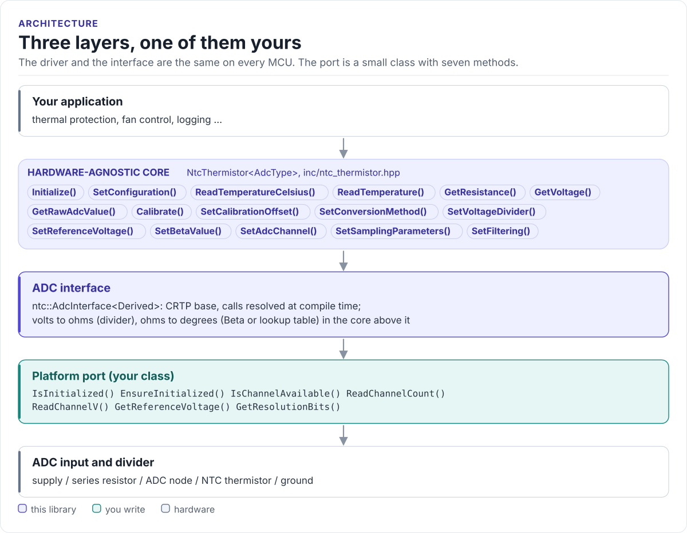
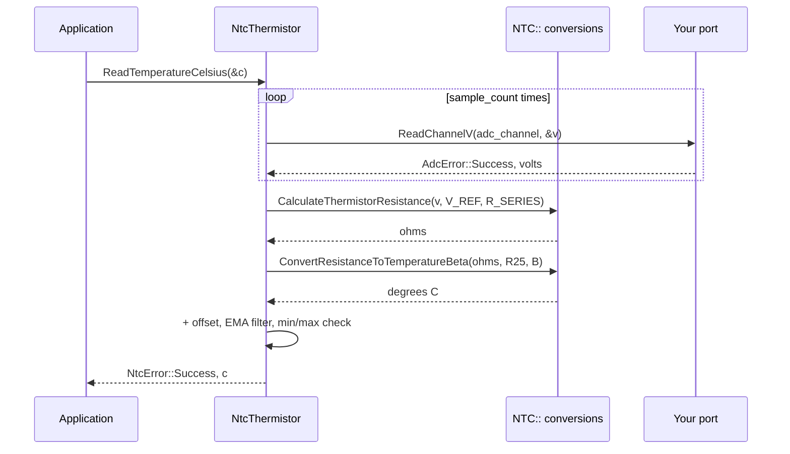

# Architecture

How the driver is put together: three layers, what each owns, and how one reading reaches the ADC.

<!-- figure: driver-layers -->
<picture>
  <source media="(prefers-color-scheme: dark)" srcset="diagrams/driver-layers.dark.svg">
  
</picture>
<!-- /figure -->

## The three layers

| Layer | Where | You change it when |
| --- | --- | --- |
| **Core**: `NtcThermistor<AdcType>`, conversions | [`inc/ntc_thermistor.hpp`](../inc/ntc_thermistor.hpp), [`src/`](../src/ntc_thermistor.ipp) | Never, for a new board |
| **ADC interface**: `ntc::AdcInterface<Derived>` | [`inc/ntc_adc_interface.hpp`](../inc/ntc_adc_interface.hpp) | Never |
| **Platform port**: your class | Your project | Once per MCU or board ([Porting](porting.md)) |

The core depends only on the port's methods; the port depends only on your SDK. Everything above the port is
the same on ESP32, STM32, a Linux host or the unit-test model. That is how the [host tests](testing.md) run the
real driver code without hardware.

## How one reading reaches the ADC

## Why CRTP

`ntc::AdcInterface` takes your class as a template parameter instead of declaring virtual functions. The
compiler sees your port's methods directly and inlines them: the ADC path has no vtable, allocates nothing and
needs no RTTI. The driver type names the port, `NtcThermistor<MyAdc>`.

`NtcThermistor` only calls the methods by name, so any class with the same seven methods works; deriving from
`ntc::AdcInterface` documents the contract and keeps the port from being copied. `NtcThermistor` itself has a
virtual destructor, so each driver object carries one vtable pointer.

## Namespaces

| Name | Namespace | Contents |
| --- | --- | --- |
| `NtcThermistor`, `ntc_config_t`, `ntc_reading_t`, `NtcError`, `NtcType` | global | The driver and its types |
| `ntc::AdcInterface`, `ntc::AdcError` | `ntc` | The port's base class and its errors |
| `NTC::Convert...`, `NTC::Calculate...`, `NTC::Constants` | `NTC` | Free conversion functions and constants |

## Source map

| Path | Contents |
| --- | --- |
| `inc/ntc_thermistor.hpp` | `NtcThermistor<AdcType>`: reading, configuration, calibration, utilities |
| `src/ntc_thermistor.ipp` | Template implementation, included by the header |
| `inc/ntc_adc_interface.hpp` | `ntc::AdcInterface<Derived>` and `ntc::AdcError` |
| `inc/ntc_types.hpp` | `ntc_config_t`, `ntc_reading_t`, `NtcError`, `NtcType`, defaults |
| `inc/ntc_conversion.hpp`, `src/ntc_conversion.cpp` | Beta, Steinhart-Hart, divider and validation functions |
| `inc/ntc_lookup_table.hpp`, `src/ntc_lookup_table.cpp` | Lookup tables and search ([status](conversion.md#lookup-table)) |
| `tests/` | Host unit tests and the compiled documentation snippets |
| `examples/esp32/` | ESP-IDF test application |
