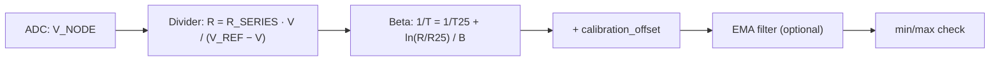

# Conversion methods

How the driver turns a voltage into a temperature, which equation each method uses and how accurate each is
for the NTCG163JF103FT1S.

## The pipeline



Every reading follows these steps in `ReadTemperatureCelsius()`: average `sample_count` voltages, solve the
divider, convert, add the calibration offset, filter, and check the result against `min_temperature` and
`max_temperature`.

## Beta equation (what the driver uses)

```text
1/T = 1/T25 + ln(R / R25) / B          T and T25 in kelvin, T25 = 298.15 K
```

`NTC::ConvertResistanceToTemperatureBeta()` implements it, and the driver calls it for
`NtcConversionMethod::Mathematical`, for `Auto` (the default) and whenever the lookup table does not cover a
reading. B is a two-point fit: the datasheet's B25/85 makes the equation exact at 25 °C and 85 °C and leaves
an error elsewhere. For the NTCG163JF103FT1S (R25 = 10 kΩ, B25/85 = 3435 K), against the spec sheet's nominal
resistance:

| Temperature (°C) | Beta reads (°C) | Error (°C) |
| ---: | ---: | ---: |
| −40 | −35.56 | +4.44 |
| −20 | −17.47 | +2.53 |
| 0 | 1.11 | +1.11 |
| 25 | 25.00 | 0.00 |
| 50 | 49.58 | −0.42 |
| 85 | 85.01 | +0.01 |
| 100 | 100.50 | +0.50 |
| 125 | 126.68 | +1.68 |
| 150 | 153.19 | +3.19 |

*Derived* from Table 3 of the [spec sheet](https://product.tdk.com/en/search/sensor/ntc/chip-ntc-thermistor/info?part_no=NTCG163JF103FT1S); the host tests check the 0 °C,
25 °C, 85 °C, 125 °C and −40 °C rows. Between 10 °C and 95 °C the error stays under 0.6 °C. Outside it, use the
Steinhart-Hart equation below, or a calibration offset near the temperature that matters to you.

Using B25/50 instead (3382 K on TDK's product page for the NTCG163JF103FT1) moves the exact points to 25 °C and
50 °C and shifts the error to higher temperatures. Use the B your datasheet gives for the range you care about.

## Steinhart-Hart equation

```text
1/T = A + B · ln(R) + C · ln(R)³
```

Three coefficients fitted at three temperatures follow the curve far better than Beta. Fitted to the
spec sheet at −40 °C, 25 °C and 125 °C, the coefficients below stay within 0.2 °C of the nominal table from
−40 °C to +125 °C and within 0.41 °C at +150 °C (*derived*):

```cpp
--8<-- "tests/docs/api_tasks.cpp:steinhart-hart"
```

The driver does not call Steinhart-Hart itself. Read the resistance with `GetResistance()` and apply the
equation, as above.

!!! warning "Library Steinhart-Hart helpers"
    `NTC::ConvertResistanceToTemperatureSteinhartHart()` rejects any C coefficient above 1 × 10⁻⁷, which
    excludes the fit for this part (C ≈ 1.9 × 10⁻⁷); `NTC::CalculateSteinhartHartCoefficients()` does not
    return a usable fit; and `NTC::ConvertResistanceToTemperatureDefault()` uses generic coefficients that
    read about 9 °C low at 85 °C for this part. Evaluate the equation yourself until these are fixed.

## Lookup table

`NtcConversionMethod::LookupTable` searches a per-type table and interpolates. The table shipped in
`src/ntc_lookup_table.cpp` does not match the NTCG163JF103FT1S datasheet: it spans 336.7 Ω down to negative
values, so a reading above 336.7 Ω (every temperature below about 145 °C) falls outside it and the driver
falls back to the Beta equation. Below 336.7 Ω the table's interpolation returns values that are wrong. Use
`Auto` or `Mathematical` until the table is regenerated from the spec sheet.

## Other conversions

| Function | Does |
| --- | --- |
| `NTC::ConvertTemperatureToResistanceBeta()` | Beta, the other way: R at a temperature |
| `NTC::CalculateBetaValue()` | B from two (temperature, resistance) points |
| `NTC::CalculateThermistorResistance()` | The divider equation |
| `NTC::CalculateThermistorVoltage()` | The divider, the other way: V<sub>NODE</sub> for a resistance |
| `NtcThermistor<>::CelsiusToFahrenheit()` and friends | Unit conversions |

```cpp
--8<-- "tests/docs/api_tasks.cpp:beta"
```

## Next

[API guide](api-guide.md) shows the calls by task; [Configuration](configuration.md) lists every setting.
