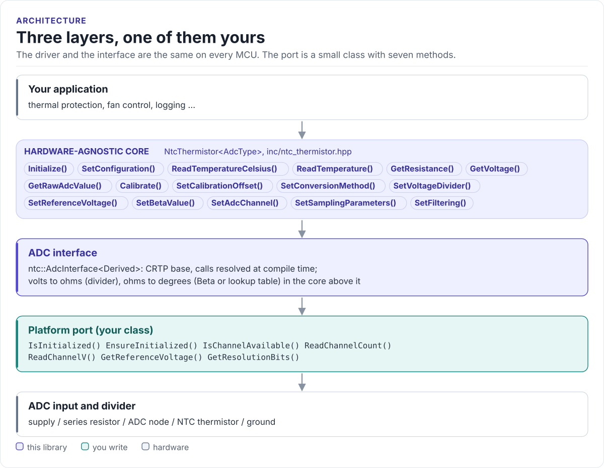

# Porting

Run the driver on a new MCU by writing one class: the ADC interface.

The driver never calls your SDK directly. It calls seven methods on a class you derive from
`ntc::AdcInterface<Self>` (in [`inc/ntc_adc_interface.hpp`](../inc/ntc_adc_interface.hpp)). The base class uses
CRTP: the calls are resolved at compile time, so there are no virtual functions, no vtable and nothing to
allocate.

<!-- figure: driver-layers -->
<picture>
  <source media="(prefers-color-scheme: dark)" srcset="diagrams/driver-layers.dark.svg">
  
</picture>
<!-- /figure -->

## What you implement

| Method | Contract |
| --- | --- |
| `IsInitialized() const` | `true` once the ADC is ready |
| `EnsureInitialized()` | Bring the ADC up if needed; `true` on success. Called by `Initialize()` |
| `IsChannelAvailable(channel) const` | `true` for a channel this port can read |
| `ReadChannelV(channel, &volts)` | One conversion, as the voltage at the pin in volts. Used for every temperature |
| `ReadChannelCount(channel, &count)` | One conversion, as the raw count. Used only by `GetRawAdcValue()` |
| `GetReferenceVoltage() const` | The ADC's full-scale voltage. Not used by the driver today |
| `GetResolutionBits() const` | The ADC's resolution. Not used by the driver today |

The read methods return `ntc::AdcError`: `Success`, or `NotInitialized`, `InvalidChannel`, `ReadFailed`,
`Timeout`, `HardwareError`. The driver maps them to `NtcError` ([API guide](api-guide.md#handle-errors)).

## The port

```cpp title="my_adc.hpp"
--8<-- "tests/docs/my_adc.hpp:port"
```

Rules for `ReadChannelV()`:

- **Return calibrated volts.** The driver's accuracy is the accuracy of this number. Use your SDK's ADC
  calibration (on ESP32, `adc_cali_raw_to_voltage()`), not `count × V_full / 4095`.
- **One conversion per call.** The driver averages `sample_count` calls itself.
- **Block until the result is ready**, or return `Timeout`.
- **Use an input range that covers the node.** With a 3.3 V divider the node spans about 0.1 V to 3.1 V
  over −40 °C to +150 °C; pick the attenuation or gain that covers it.

## Reference implementation

The ESP32 example's port, [`mock_esp32_adc.hpp`](../examples/esp32/main/mock_esp32_adc.hpp), is a simulated
ADC: it returns a fixed mid-scale count and does not touch the hardware. It shows the shape of a port, not an
ESP-IDF ADC driver. On ESP-IDF, implement `EnsureInitialized()` with `adc_oneshot_new_unit()`,
`adc_oneshot_config_channel()` and an `adc_cali` scheme, and `ReadChannelV()` with `adc_oneshot_read()` and
`adc_cali_raw_to_voltage()`.

## Check your port

1. Build it: the port on this page is compiled by the host CI from
   [`tests/docs/my_adc.hpp`](../tests/docs/my_adc.hpp), with the driver instantiated over it.
2. Replace the thermistor with a 10 kΩ 0.1 % resistor: `GetVoltage()` returns half the supply and
   `ReadTemperatureCelsius()` returns 25 °C within a few
   tenths of a degree, set by the two resistors and the ADC calibration.
3. Short the node to ground: `ConversionFailed`. Open the thermistor: `ConversionFailed`, or
   `TemperatureOutOfRange` if ADC noise keeps the node just under the supply.

## Threads

The driver is not thread-safe. Give each `NtcThermistor` one owner task, or guard every call on a driver object
(and its ADC port) with one mutex. Several thermistors on one port need that mutex around the port too.
